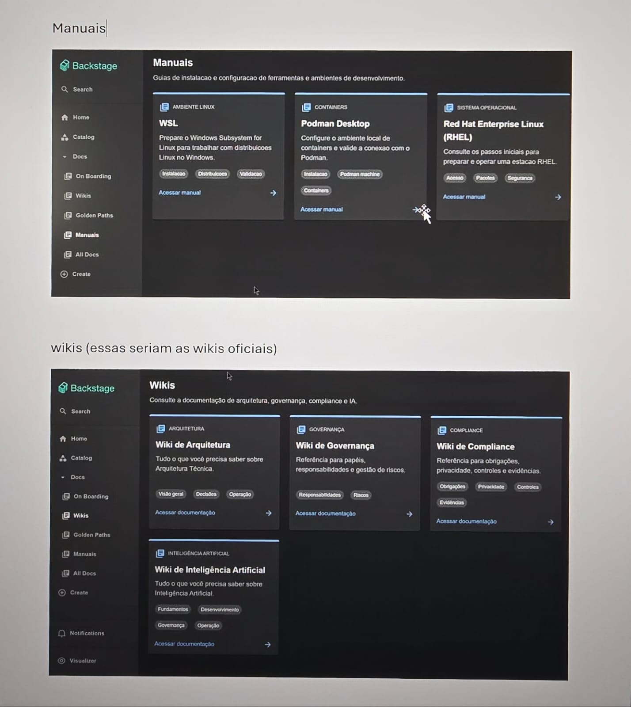
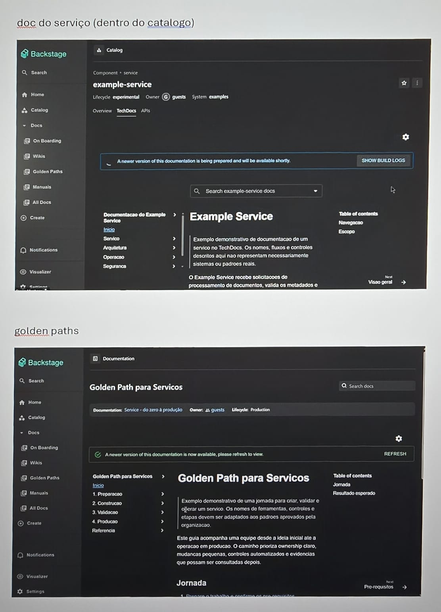

# Wiki de Demonstração

Bem-vindo! Esta wiki mostra como editar documentação sem precisar conhecer Git.

## Como editar

1. Abra a página que quer alterar.
2. Clique em **Editar esta página**.
3. Escreva como num editor de texto comum.
4. Clique em **Salvar rascunho** e depois em **Enviar para revisão**.

!!! tip "Dica"
    Enquanto o rascunho não é enviado, ninguém além de você vê as alterações.

## Conteúdo

- [Primeiros passos](guias/primeiros-passos.md)
- [Processo de aprovação](processos/aprovacao.md)

## Exemplo de imagem

